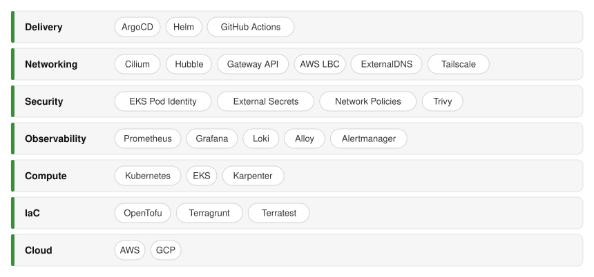

# Axel Mendoza

Senior MLOps & Platform Engineer, bridging the gap between Kubernetes and ML. I build in the open and write about it on [my blog](https://www.axelmendoza.com).

## What I'm Working on

**[EKS Forge](https://github.com/ConsciousML/eks-forge)**: an open-source platform for building and operating Kubernetes on AWS. Fork it, understand it, run it in about a day.

## Stack

## Let's connect

[Blog](https://www.axelmendoza.com) · [LinkedIn](https://www.linkedin.com/in/axelmdz/) · [Email](mailto:axelmendoza@hotmail.fr)
